# Troika Music Lessons — Admin Guide

This guide is for the person who runs the school day to day in the Troika app.
Open it whenever you are stuck or want to know how to do something.

- Each "How do I…?" section is a short list of steps. Do them in order.
- Words in **bold** are buttons or boxes, written exactly as they appear on screen.
- Where it says **click**, you can also **tap** on a phone or tablet.
- Money is in Indian Rupees (₹).

---

## Contents

**Start here**
- [Signing in](#signing-in)
- [Finding your way around](#finding-your-way-around)

**Students**
- [How do I add a new student?](#how-do-i-add-a-new-student)
- [How do I approve someone who signed up?](#how-do-i-approve-someone-who-signed-up)
- [Brothers and sisters: one login for a family](#brothers-and-sisters-one-login-for-a-family)
- [How do I find a student and see their details?](#how-do-i-find-a-student-and-see-their-details)
- [How do I put a student in a class, or add a second class?](#how-do-i-put-a-student-in-a-class-or-add-a-second-class)
- [How do I mark a student absent?](#how-do-i-mark-a-student-absent)
- [How do I remove a student or stop their classes?](#how-do-i-remove-a-student-or-stop-their-classes)

**Lessons and the timetable**
- [How do I see today's lessons?](#how-do-i-see-todays-lessons)
- [How do I cancel a lesson?](#how-do-i-cancel-a-lesson)
- [A teacher is absent. How do I give the class to another teacher?](#a-teacher-is-absent-how-do-i-give-the-class-to-another-teacher)
- [How do I see and approve a student's "can't attend" request?](#how-do-i-see-and-approve-a-students-cant-attend-request)
- [How do I create a group class and add students?](#how-do-i-create-a-group-class-and-add-students)
- [How do I schedule a one-time workshop?](#how-do-i-schedule-a-one-time-workshop)
- [How do I put students on a break (holiday)?](#how-do-i-put-students-on-a-break-holiday)
- [How do I reschedule missed lessons?](#how-do-i-reschedule-missed-lessons)

**Money**
- [How do I set a teacher's prices?](#how-do-i-set-a-teachers-prices)
- [How do I record a payment?](#how-do-i-record-a-payment)
- [How do I send a payment reminder or receipt on WhatsApp?](#how-do-i-send-a-payment-reminder-or-receipt-on-whatsapp)
- [I marked the wrong payment as paid. How do I undo it?](#i-marked-the-wrong-payment-as-paid-how-do-i-undo-it)
- [How do I add an extra charge (books, recital ticket)?](#how-do-i-add-an-extra-charge-books-recital-ticket)
- [How do I renew students for next year?](#how-do-i-renew-students-for-next-year)
- [How do I see reports or download them to Excel?](#how-do-i-see-reports-or-download-them-to-excel)

**Setting up**
- [How do I add a new location?](#how-do-i-add-a-new-location)
- [How do I sync lessons to a phone calendar?](#how-do-i-sync-lessons-to-a-phone-calendar)

**Reference**
- [Fees and lessons at a glance](#fees-and-lessons-at-a-glance)
- [What these words mean](#what-these-words-mean)

---

## Signing in

1. Open the Troika app in your web browser.
2. Click **Continue with Google**, or click **Sign in with email and password**, type your **Email** and **Password**, and click **Sign In**.
3. Forgot your password? Type your email, then click **Forgot password?**. A reset link is sent to your email.

> **Good to know:** Teachers and students who sign up themselves can't see anything until you approve them. See [How do I approve someone who signed up?](#how-do-i-approve-someone-who-signed-up)

---

## Finding your way around

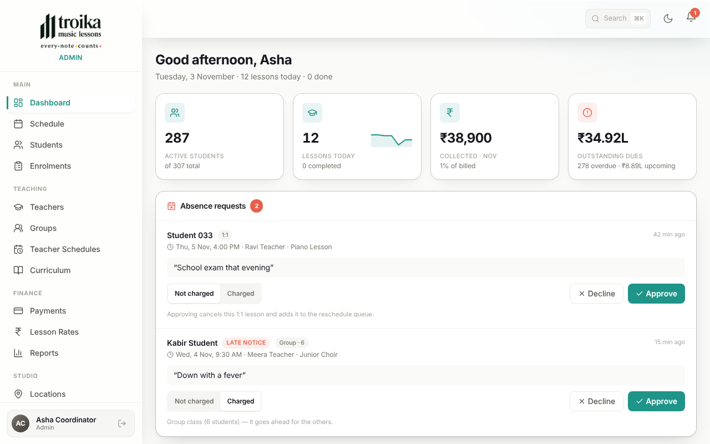

**The menu on the left** has four groups. Click any item to open that page.
On a phone, the menu is hidden: tap the **☰** button at the top left to open it.

| Menu item | What it is for |
|---|---|
| **Main** | |
| **Dashboard** | Your home page: today's numbers, today's lessons, "can't attend" requests, and who owes money. |
| **Schedule** | Every lesson, by day or by week. Cancel a lesson, change its teacher, add a one-off lesson. |
| **Students** | The list of all students. Add a student, approve new sign-ups, open a student's page. |
| **Enrolments** | Each student's classes for the year and their fee plan. Put a student in a class, renew for next year. |
| **Teaching** | |
| **Teachers** | The list of teachers. Approve new teachers here. |
| **Groups** | Group classes (choir, ensemble…) and one-time sessions such as workshops. |
| **Teacher Schedules** | Each teacher's weekly timetable. Most slots appear here by themselves when you put a student in a class. |
| **Curriculum** | The library of pieces and exercises teachers use. Click **Upload Excel** to add more. |
| **Finance** | |
| **Payments** | Every instalment and charge. Record payments, send reminders and receipts. |
| **Lesson Rates** | The price of one lesson, for each teacher, place and type of class. |
| **Reports** | Totals for the school and per student. Download to Excel. |
| **Studio** | |
| **Locations** | The places where lessons happen (for example Edvin, Links, Online, Student's Home). |
| **Breaks** | Holidays and time off, and lessons waiting to be rescheduled. |

**At the top of every page:**

- **Search** (or press **Ctrl + K** on Windows, **⌘ + K** on a Mac): type a page name or a student's name and press Enter to jump straight there.
- **Moon / sun button:** switches between light and dark colours.
- **Bell:** your notifications. A red number means you have unread ones. Click **Mark all read** to clear them.

**At the bottom of the menu** you see your name. The arrow button next to it signs you out.

---

## How do I add a new student?

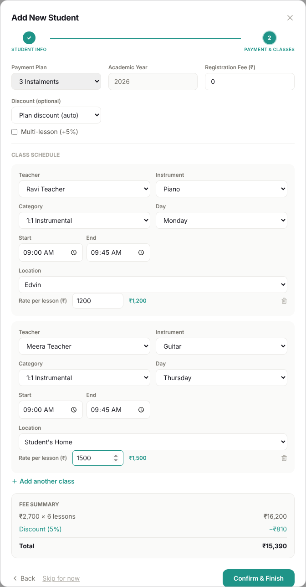

1. Click **Students** in the menu, then **+ Add Student**.
2. Fill in **Full Name** (required), **Phone**, **Email**, **Location** (where they usually learn) and **Address**. Click **Next: Payment & Classes**.
3. Choose the **Payment Plan** (1, 3 or 10 instalments, or **Trial (no payment)**). Type a **Registration Fee (₹)** if there is one. Choose a **Discount (optional)** if they get one.
4. Under **Class Schedule**, choose the **Teacher**, **Instrument**, **Location** for this class, and **Times per week** (1×, 2× or 3×).
5. Choose the **Day**, **Start** and **End** time. For 2× or 3× a week, fill in a day and time for **Lesson 2** (and **Lesson 3**) too. Each lesson must be on a different day or time. If the teacher already has another student at that time, a red **Clash** message names that student. Pick another time; you can't save until you do.
6. Type the **Rate per lesson (₹)**, the price of **one** lesson for this student (for example 1200). The box starts empty; you always type the price yourself. **Confirm & Finish** stays grey until every class has a teacher and a rate.
7. Learning a second instrument? Click **+ Add another class** and fill in the second class the same way. Each class can be at a different place (for example guitar at home, piano at Edvin).
8. Check the **Fee Summary** at the bottom, then click **Confirm & Finish**. The app creates the lessons and the payment instalments.

> **Good to know:** The total is *rate per lesson × number of lessons for the year*. A class twice a week has twice the lessons, so twice the fee (for example *₹1,200 × 78 lessons (39 × 2 per week)*). Minus any discount, plus the registration fee. The number of lessons depends on the month the student joins (see [Fees and lessons at a glance](#fees-and-lessons-at-a-glance)). Not ready to choose classes? Click **Skip for now**. The student is saved without classes or bills.

---

## How do I approve someone who signed up?

Students, parents and teachers can sign up on their own, but they see only a "waiting for approval" screen until you approve them.

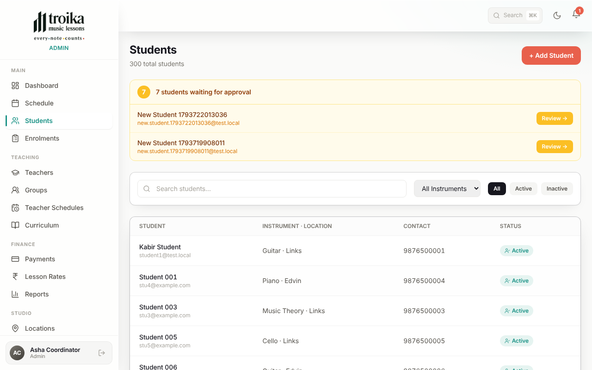

**A student or parent:**

1. Click **Students**. A yellow box at the top says how many students are **waiting for approval**.
2. Click **Review →** next to the name.
3. The **Approve & Onboard** form opens. It is the same as adding a new student (see [How do I add a new student?](#how-do-i-add-a-new-student)). Their email is already filled in.
4. Check **Child's (student's) full name**. A parent often types their **own** name when signing up, so change it to the child's name.
5. Add their classes and click **Confirm & Finish**. You can also click **Skip for now** to approve them without classes.
6. Has the parent got another child at Troika? Click **Add another child to this login**. See [Brothers and sisters](#brothers-and-sisters-one-login-for-a-family).

**A teacher:**

1. Click **Teachers**. A box at the top says how many teachers are **waiting for approval**.
2. Click **Review →**.
3. Check their **Full Name** and **Phone**, then click **Approve Teacher**. If you don't know this person, click **Deny**.

---

## Brothers and sisters: one login for a family

A parent with two or three children at Troika signs up **once**, with one email. All the children sit under that one login. Each child still has their **own** classes, rate, lessons left, instalments, payments and invoices. Only the login is shared.

**When the parent signs up:**

1. Approve them as usual: **Students → Review → Approve & Onboard**. Type the **first child's name** and add their classes. Click **Confirm & Finish**.
2. The last screen lists the children set up so far. Click **Add another child to this login (parent's email)**.
3. The form opens again with the parent's email, phone and location already filled in. Type the **second child's name** and add their classes. Click **Confirm & Finish**.
4. Repeat for a third child, then click **Done**.

**Brothers and sisters in the same class:** give the second child the **same teacher, day and start time** as the first. Instead of a clash you'll see a green message: **shared with [first child] (same family)**. They sit in the same lesson, and **each child pays for their own place**. This only works for children in the same family (same login or same email). Any other student at that time shows a **Clash**.

**Adding a brother or sister later:** click **+ Add Student** and type the **same parent email**. The child joins the family login by itself.

**What the parent sees:** a button for each child (and **All**) at the top of the app. Each lesson and payment shows the child's name. In "can't attend" requests the parent picks which child.

**Fixing a mistake (the Family login box):**

1. Open the child's page (**Students → the child's name**). On **Overview**, the **Family login** box shows which login this child is under, and the other children on it.
2. Wrong login? Click **Change** and search for the right parent by name or email. To take the child off the login, click **Unlink**.
3. Confirm. The change is immediate.

> **Good to know:** On the **Payments** page each child appears separately, with their own instalments. A family pays per child.

---

## How do I find a student and see their details?

1. Click **Students**. Type in **Search students...**, or use the **All Instruments** list and the **All / Active / Inactive** buttons to narrow the list.
2. Click the student's name to open their page.
3. The tabs at the top show:
   - **Overview:** contact details and parent or guardian.
   - **Enrolment:** each class for the year, with **lessons remaining**, **Rate / Lesson**, **Total Fee** and **Payment Plan**.
   - **Schedule:** their weekly class times.
   - **History:** their last 50 lessons and whether they came.
4. To change details (phone, parent, notes, location), click **Edit**, make your changes, and click **Save Changes**.

---

## How do I put a student in a class, or add a second class?

Use this for a student who is **already in the app**. (For a brand-new student, use **+ Add Student**, which does both at once.)

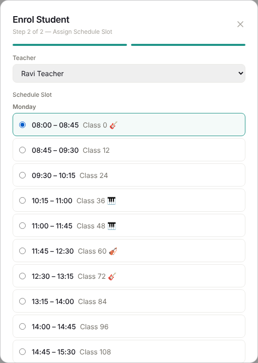

1. Click **Enrolments**, then **Enrol Student**.
2. Choose the **Student**, the **Times per week** (1×, 2× or 3×), and type the **Rate per lesson (₹)**, the price of one lesson for this student. The box starts empty.
3. Choose the **Payment Plan**, **Start Date**, **End Date**, **Registration Fee (₹)** and **Discount (optional)**. Check the **Fee Summary**, then click **Next**.
4. Choose the **Teacher**. Then, under **Schedule Slot**, choose one for each weekly lesson (one for 1×, two for 2×, three for 3×):
   - one of the teacher's **existing classes** (the list shows who is in each). Pick one only to put the student **in that same class**, for example a brother or sister, or a group. Each student pays for their own place. Or:
   - **+ New day and time**: choose the **Day**, **Start**, **End**, **Instrument** and a **Title**. If that time overlaps another class of this teacher, a **Clash** message names the student already there.
5. Click **Save & Generate Lessons**.
6. For another instrument, click **+ Add another class for [name]** and repeat. Click **Done** when finished.

> **Good to know:** If some weeks clash with the teacher's other lessons, a yellow warning lists the dates that were skipped. Add those lessons from the **Schedule** page, or pick another time.

---

## How do I mark a student absent?

1. Open the student's page (**Students** → click the name) and click the **History** tab.
2. Find the lesson. Click **Present** if they came, or **Absent** if they didn't.
3. For **Absent**, choose **Charged** (the lesson is used up) or **Not Charged** (for example, the teacher cancelled). Click **Confirm Absence**.

> **Good to know:** Teachers usually mark attendance themselves from their own app. You only need to do this to fix something.

---

## How do I remove a student or stop their classes?

**To stop one class** (the student keeps their other classes):

1. Click **Enrolments** and find the student's class in the list.
2. Click **Delete**, then **Delete** again to confirm.
3. Unpaid instalments and upcoming lessons for that class are removed. Payments already made and past lessons are kept.

**When a student leaves the school:**

1. Stop each of their classes as above.
2. Open the student's page and click **Deactivate**. They are hidden from your lists but nothing is lost. **Activate** brings them back.

> **Good to know:** **Delete** on a student's page removes them forever. It only works for someone with no payments or invoices (for example, a test entry or a mistake). Anyone who has paid must be **deactivated** instead.

---

## How do I see today's lessons?

1. The **Dashboard** shows **Today's schedule**. Click **Open schedule →** for more.
2. On the **Schedule** page, use **Day** or **Week**, the **‹ ›** arrows and **Today** to move around.
3. Use **All Teachers** and **All Instruments** to show only one teacher or instrument.
4. In **Day** view, click a lesson to open it. You will see its students and these buttons: **Mark completed**, **Change teacher**, **Cancel this lesson**, and **Find makeup** next to each student.

> **Good to know:** A lesson marked **On break** means the student is on holiday, so that time is free only for now. **Find makeup** suggests other students, at the same place, who are owed a lesson.

---

## How do I cancel a lesson?

1. Click **Schedule**, choose **Day** view, and go to the date.
2. Click the lesson to open it, then click **Cancel this lesson**.
3. Type a **Reason (optional)**. Students see this reason.
4. Click **Cancel Lesson**. (Click **Keep Lesson** if you changed your mind.)

The students get a notification in their app that the lesson is cancelled.

---

## A teacher is absent. How do I give the class to another teacher?

**For one lesson:**

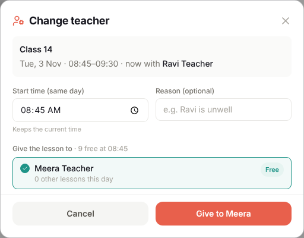

1. Click **Schedule**, choose **Day** view, and click the lesson.
2. Click **Change teacher**.
3. If needed, change the **Start time (same day)** and type a **Reason (optional)**.
4. Pick a teacher marked **Free**. Teachers marked **Busy** already have a lesson then.
5. Click **Give to [name]**. Teachers and students are notified.

**For the teacher's whole day:**

1. On the **Schedule** page, click **Cover a teacher**.
2. Choose the **Teacher who is away** and the **Date**.
3. Choose one teacher in **Substitute for all lessons**, or choose a different teacher for each lesson. Untick any lesson you don't want to move.
4. Click **Reassign [number] lessons**, then **Done**.

---

## How do I see and approve a student's "can't attend" request?

Students and parents can tap **Can't attend** on an upcoming lesson in their app and give a reason. These requests appear on your **Dashboard**.

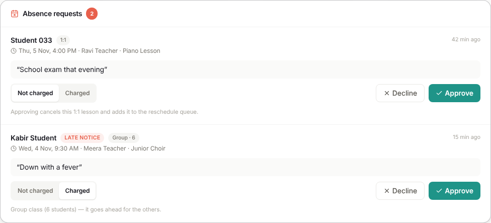

1. Click **Dashboard** and look at the **Absence requests** box. The red number shows how many are waiting.
2. Read the student's name, the lesson and their reason. **Late notice** means they told you less than 24 hours before.
3. Choose **Not charged** or **Charged**. (For late notice, **Charged** is chosen for you. You can change it.)
4. Click **Approve**. Or click **Decline**, type a **Note to the student (optional)**, and click **Confirm decline**.

> **Good to know:** For a 1:1 lesson, approving cancels the lesson. If it is **Not charged**, the lesson also goes on the list to reschedule. For a group class, the class still goes ahead for the others. Past decisions are under **Recent decisions**.

---

## How do I create a group class and add students?

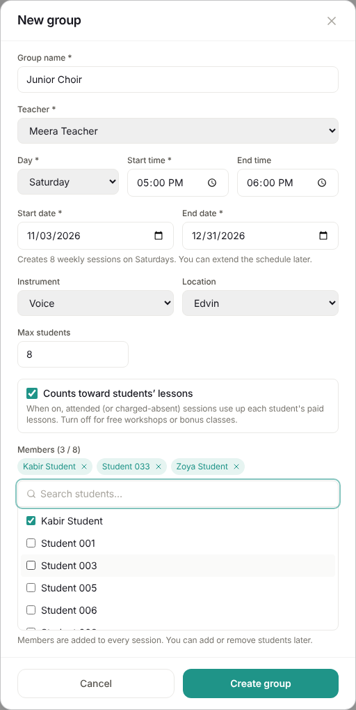

1. Click **Groups**, then **New group**.
2. Fill in **Group name**, **Teacher**, **Day**, **Start time**, **End time**, **Start date** and **End date**. Add the **Instrument**, **Location** and **Max students** if you want.
3. Leave **Counts toward students' lessons** ticked if each session uses up one of the students' paid lessons. Untick it for free or bonus classes.
4. Tick the students under **Members**, then click **Create group**. All the weekly sessions are created.
5. Later, click the group to open it:
   - **Add students**: choose students and the date they **Joins sessions from**.
   - **Remove** (next to a name): choose the date they **Leave sessions from**. Past attendance is kept.
   - **Extend schedule**: add more weeks.
   - **Edit**: change the name, location or maximum.
   - **End group**: removes sessions that haven't happened yet. Past sessions are kept.

> **Good to know:** You can also join a student to an existing group from **Enrolments → Enrol Student** by picking the group's time under **Schedule Slot**. Do this when the group class is part of the student's paid yearly plan.

---

## How do I schedule a one-time workshop?

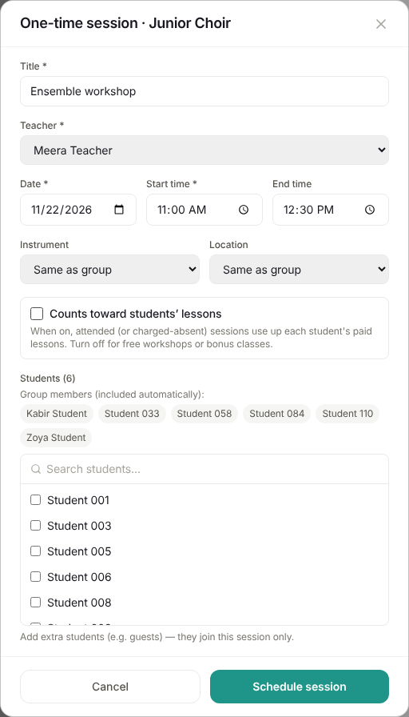

1. Click **Groups**, then **One-time session**.
2. Under **For a group (optional)**, choose a group, or choose **No group — a one-off class (workshop, masterclass…)**.
3. Fill in the **Title**, **Teacher**, **Date**, **Start time**, **End time**, and the **Instrument** and **Location** if needed.
4. Decide on **Counts toward students' lessons**. Untick it for a free workshop.
5. Tick the students who will come, then click **Schedule session**.

> **Good to know:** To charge a separate fee for a workshop (for example ₹500), add it as an extra charge on the **Payments** page. See [How do I add an extra charge?](#how-do-i-add-an-extra-charge-books-recital-ticket)

---

## How do I put students on a break (holiday)?

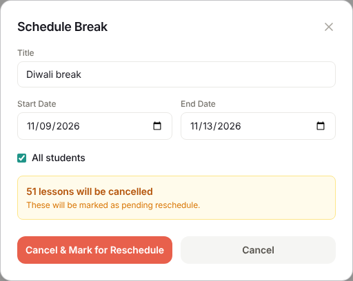

1. Click **Breaks**, then **New Break**.
2. Type a **Title** (for example "Family trip" or "Diwali break"), then the **Start Date** and **End Date**.
3. Tick the students who are away. Tick **All students** only for a holiday when the whole school is closed.
4. Click **Preview**. It shows how many lessons will be cancelled.
5. Click **Cancel & Mark for Reschedule**.

> **Good to know:** If a student on break is in a group class, the class still goes ahead for everyone else. Only that student is taken out.

---

## How do I reschedule missed lessons?

Lessons cancelled by a break (or an approved "not charged" absence) wait in **Pending Reschedules** on the **Breaks** page.

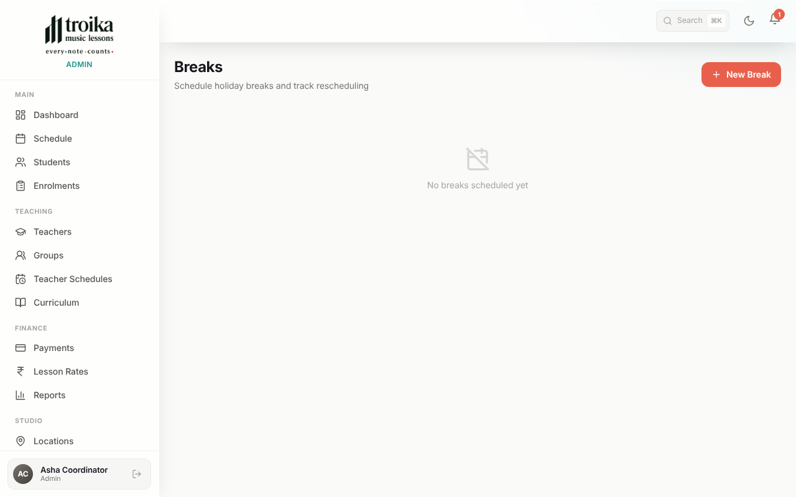

**Let the app find times:**

1. Click **Breaks**. On the break's card, click **Auto-Reschedule** (or **Auto-Reschedule After Break** in the list below).
2. Check the suggested new times. Lessons marked **no slot — reschedule manually** need you to do them by hand.
3. Click **Confirm & Create [number] Lessons**.

**Do one by hand:**

1. Under **Pending Reschedules**, click a lesson.
2. The calendar next to it shows when the teacher is free. Click a future date.
3. Choose the **New Date** and **New Time**, then click **Create Makeup**.

---

## How do I set a teacher's prices?

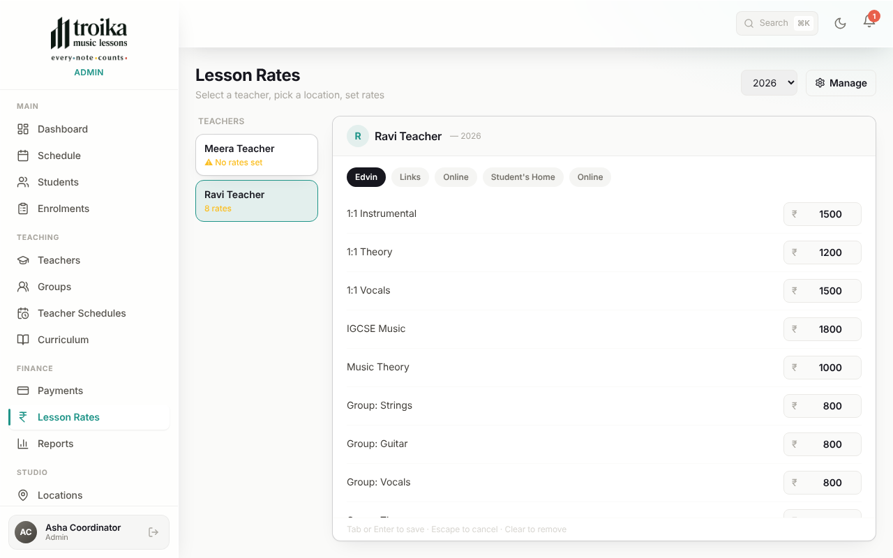

1. Click **Lesson Rates**. Check the year in the box at the top right.
2. Click a teacher on the left. **⚠ No rates set** means that teacher has no prices yet.
3. Click a place along the top (for example **Edvin**, **Links**, **Online**).
4. Type the price of one lesson next to each type of class. Press **Tab** or **Enter** to save. Clear the box to remove a price.
5. Repeat for each place this teacher teaches.

> **Good to know:** This page is a price list for you to look at. The app does **not** fill in prices by itself: you type the **Rate per lesson** for each student when you add them. Changing a price here does **not** change what existing students pay. To add a new instrument, type of class or place, click **Manage**.

---

## How do I record a payment?

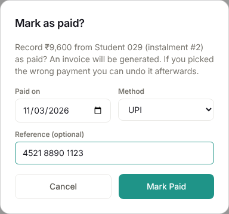

1. Click **Payments**. Click **Overdue**, **Upcoming** or **Paid** at the top to show only those. Click it again to show everything.
2. Find the student, or type in **Search by student or charge…**.
3. Click **Mark Paid** on the right line.
4. Check **Paid on** (the date you got the money). Choose the **Method** (**Cash**, **UPI**, **Bank transfer**, **Cheque** or **Other**). Type a **Reference (optional)**, like the UPI transaction ID or cheque number.
5. Click **Mark Paid**. An invoice is made by itself. Its number appears in the **Invoice** column. Click the number to open the invoice.

> **Good to know:** If the invoice could not be made, the payment is still saved. Click **Generate invoice** on that line to try again.

---

## How do I send a payment reminder or receipt on WhatsApp?

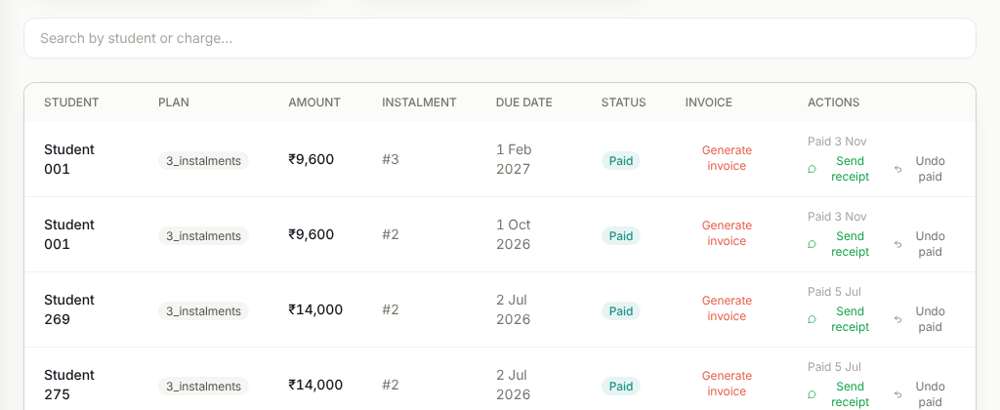

**Reminder (money not yet paid):**

1. Click **Payments** and find the unpaid line.
2. Click **Remind**. WhatsApp opens with a polite message showing the amount and due date.
3. Check the message and press send in WhatsApp.

**Receipt (money received):**

1. Right after you click **Mark Paid**, a message appears with a **Send receipt** button. Or click **Send receipt** on any line in the **Paid** list.
2. WhatsApp opens with a thank-you message, the amount, the date, and a link to the invoice. Press send.

> **Good to know:** Messages go to the parent's phone number, or to the student's if there is no parent number. If neither is saved, add one with **Edit** on the student's page. The invoice link in the message works for 7 days.

---

## I marked the wrong payment as paid. How do I undo it?

1. Click **Payments**, then **Paid**.
2. Find the line and click **Undo paid**.
3. Read the message and click **Undo paid** to confirm. The payment goes back to unpaid.

> **Good to know:** The invoice for that payment is cancelled, and its number is never used again. When you mark it paid again, it gets a new invoice number. This keeps your invoice records honest.

---

## How do I add an extra charge (books, recital ticket)?

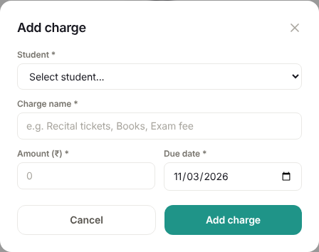

1. Click **Payments**, then **Add charge**.
2. Choose the **Student**.
3. Type a **Charge name** (for example "Recital tickets", "Books" or "Exam fee"), the **Amount (₹)** and the **Due date**.
4. Click **Add charge**. It appears in **Payments** like any other bill. You can remind, mark paid and send a receipt in the same way.

---

## How do I renew students for next year?

Use this near the end of the year to put everyone into the new year's classes in one go.

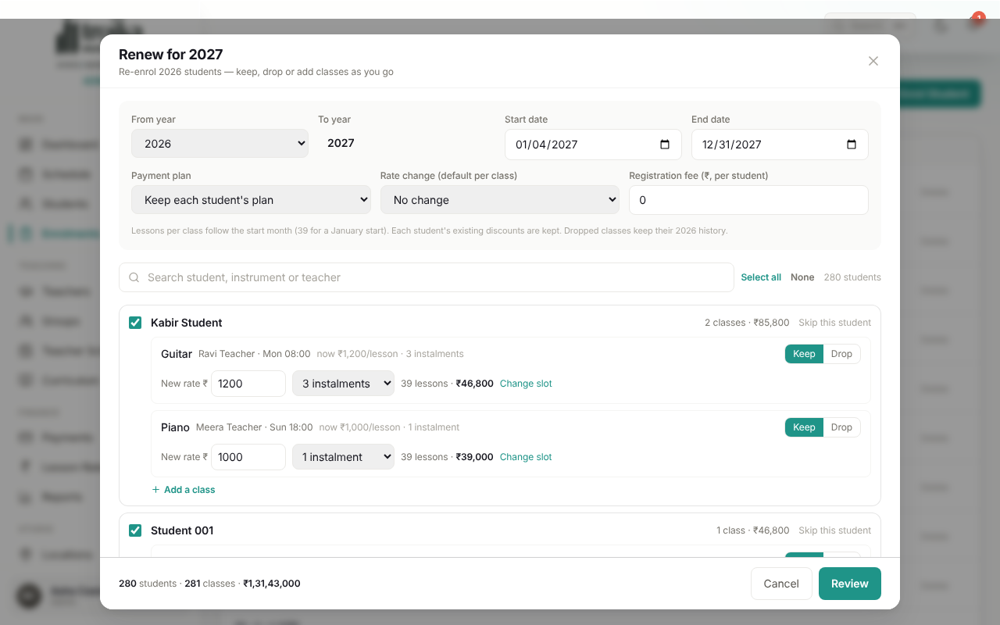

1. Click **Enrolments**, then **Renew for next year**.
2. At the top, check the **From year**, the **Start date** and the **End date**. Choose the **Payment plan** (**Keep each student's plan**, or one plan for everyone), any **Rate change** (**+ % increase** or **+ ₹ per lesson**), and the **Registration fee (₹, per student)**.
3. Go down the list of students. For each class, click **Keep** or **Drop**. You can change the **New rate ₹** and the plan, or click **Change slot** to move the class to another time or change how many times a week it runs. A twice-a-week class keeps both its days.
4. Click **Add a class** to give a student a new class (type its rate; the box starts empty). Click **Skip this student** for anyone who is leaving.
5. Click **Review**. If you see **Fix these first**, go **Back** and fix those lines.
6. Click **Renew [number] students**. Keep the window open until it finishes, then click **Done**.

> **Good to know:** It is safe to run again. Students already renewed show **Already renewed** and are skipped. Each student's discounts carry over. Dropped classes keep their old history.

---

## How do I see reports or download them to Excel?

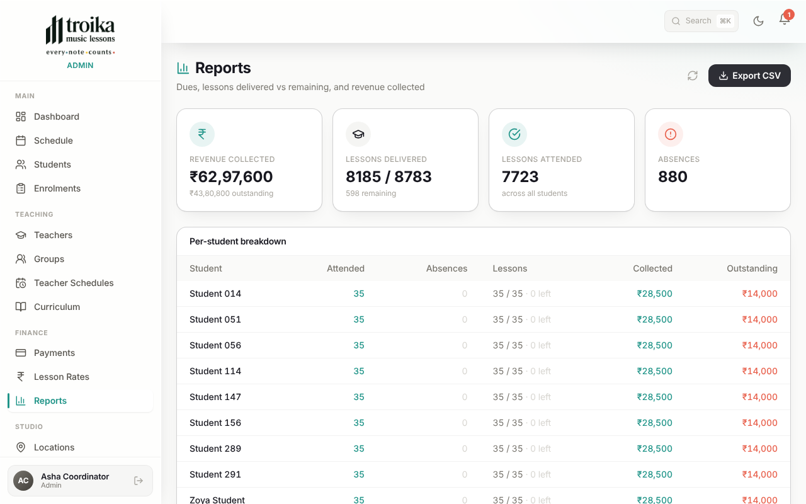

1. Click **Reports**. The boxes at the top show **Revenue collected**, **Lessons delivered**, **Lessons attended** and **Absences**.
2. The **Per-student breakdown** table lists every student: lessons attended, absences, lessons, money collected and money still owed.
3. Click **Export CSV** to download it. The file opens in Excel or Google Sheets and has a totals line at the bottom.

---

## How do I add a new location?

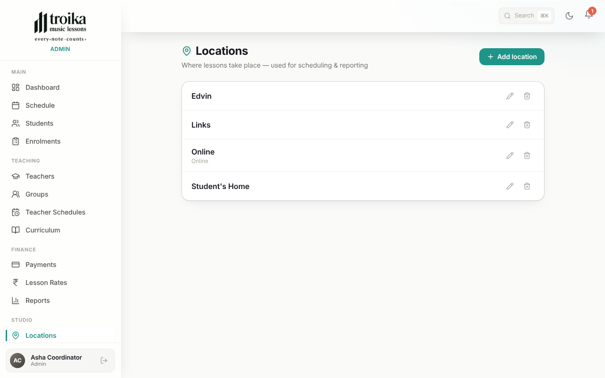

1. Click **Locations**, then **Add location**.
2. Type the **Name** (for example "Edvin" or "Student's Home"). **Address**, **City** and **Zone** are optional.
3. Click **Add**. The new place now appears in every location list in the app.
4. To change a place, click the pencil button. To remove it, click the bin button.

> **Good to know:** A place that is used by lessons, students or prices can't be deleted. After adding a place, set teachers' prices for it in **Lesson Rates**.

---

## How do I sync lessons to a phone calendar?

Teachers, students and parents can see their Troika lessons in Google Calendar, Apple Calendar (iPhone) or Outlook. The calendar updates by itself. (The admin account does not have this button. It is only in the teacher and student apps.)

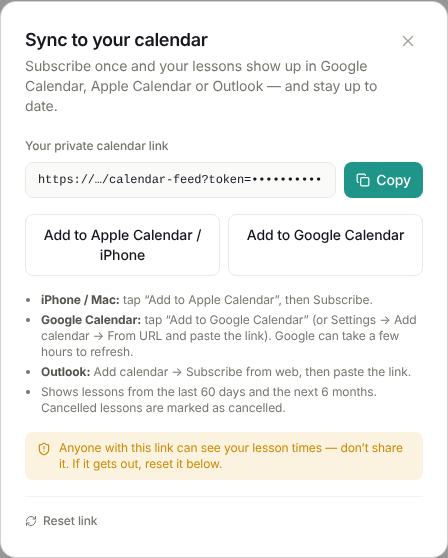

Tell the teacher or parent to:

1. Open **Calendar** in their Troika app and tap **Sync to calendar**.
2. Tap **Add to Apple Calendar / iPhone** and then **Subscribe**, or tap **Add to Google Calendar**.
3. Keep the link private. Anyone who has it can see their lesson times. If it is shared by mistake, tap **Reset link** and add the new link again.

> **Good to know:** Google Calendar can take a few hours to show changes.

---

## Fees and lessons at a glance

**How many lessons in a year?** It depends on the month the student joins. You never type it in.

| Joins in | Jan | Feb | Mar | Apr | May | Jun | Jul | Aug | Sep | Oct | Nov | Dec |
|---|---|---|---|---|---|---|---|---|---|---|---|---|
| Lessons | 39 | 39 | 35 | 31 | 28 | 24 | 21 | 17 | 13 | 10 | 6 | 3 |

**Twice a week?** Double it (for example 39 × 2 = 78 lessons if joining in January). Three times a week: × 3.

A **Trial** is always 1 lesson, with no payment.

**Payment plans**

- **1 Instalment:** pay everything at the start.
- **3 Instalments:** at the start, after 4 months, and after 8 months.
- **10 Instalments:** once a month.
- The registration fee is added to the **first** instalment.

**Discounts:** choose one, and you can add **Multi-lesson (+5%)** on top of it. Discounts never apply to the registration fee.

- **Plan discount (auto):** 10% for 1 instalment, 5% for 3, nothing for 10.
- **Legacy student (25%):** for long-standing students.
- **Flat ₹ special:** a fixed amount you type in.

---

## What these words mean

- **Rate per lesson:** the price of one lesson for this student, in ₹. You type it in.
- **Times per week:** how many lessons a week a class has (1×, 2× or 3×). Still one class, one bill.
- **Family login:** one parent email that several children are under. Each child is billed separately.
- **Instalment:** one part of the yearly fee. The fee is split into 1, 3 or 10 instalments.
- **Enrolment (class):** one student learning one instrument with one teacher for the year. A student can have several.
- **Charged absence:** the student missed the lesson but it still counts as used and paid for.
- **Not charged absence:** the student missed the lesson and does not lose it. It can be rescheduled.
- **Counts toward lessons:** the session uses up one of the student's paid lessons. Untick it for free workshops or bonus classes.
- **Slot:** a fixed weekly time with a teacher, for example "Monday 4:00–4:45 with Ravi".
- **Group class:** one weekly class with several students, created on the **Groups** page.
- **Break:** a holiday or time off. Lessons in that time are cancelled and wait to be rescheduled.
- **Makeup lesson:** an extra lesson that replaces a missed or cancelled one.
- **Deactivate:** hide a student who has left, keeping all their records. Different from **Delete**, which removes them forever.
- **Invoice number:** every payment gets its own invoice number. A number is never reused, even after **Undo paid**.
